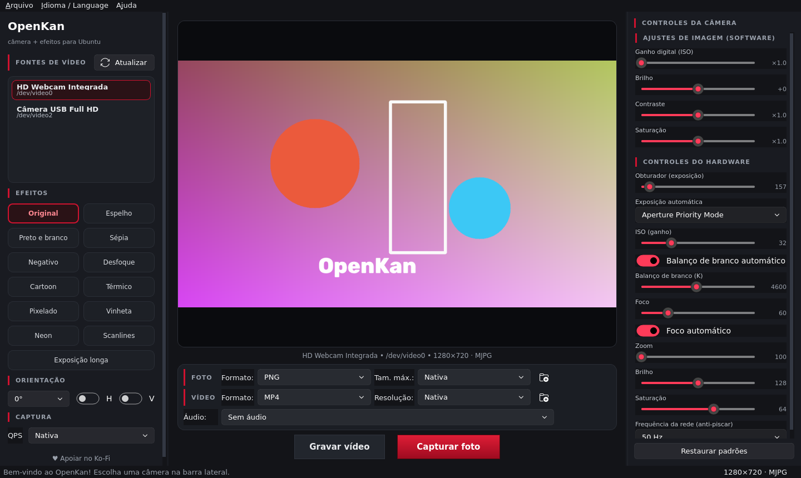

# OpenKan 🎥

**Câmera com efeitos em tempo real para Ubuntu** — inspirado no [Webcamoid](https://webcamoid.github.io/), escrito em Python + PyQt6 + OpenCV.



## Recursos

- **Preview em tempo real** com baixa latência (buffer sempre com o quadro mais recente)
- **Troca de câmera** ao vivo: todas as fontes V4L2 detectadas aparecem na barra lateral — clique para trocar sem reiniciar
- **12 efeitos em tempo real**: Original, Espelho, Preto e branco, Sépia, Negativo, Desfoque, Cartoon, Térmico, Pixelado, Vinheta, Neon e Scanlines
- **Orientação**: rotação de 0°/90°/180°/270° e espelhamento horizontal/vertical
- **Controles manuais da câmera** (lidos direto do driver V4L2 — cada webcam mostra o que tem):
  - Obturador (exposição) com modo automático/manual
  - ISO (ganho), Foco e Zoom
  - **Abertura da lente (íris)** — quando o hardware expõe o controle
  - Balanço de branco automático e temperatura (K)
  - Brilho, contraste, saturação, matiz, nitidez, gama, anti-piscar (50/60 Hz) e mais
  - Botão **Restaurar padrões** para voltar ao estado de fábrica
- **Fotos** em PNG ou JPEG, com tamanho máximo opcional
- **Vídeos** em **MP4, MKV, AVI ou WebM**, com resolução escolhível (nativa, 1080p, 720p, 480p, 360p)
- **Gravação com áudio** — escolha a fonte (microfone, saída do sistema…) via PulseAudio/PipeWire
- **Pastas escolhíveis** para fotos e vídeos (ícone de pasta na barra de ajustes), com menus "Abrir pasta das fotos / dos vídeos"
- **Interface bilíngue** (português e inglês) trocável no menu **Idioma / Language**, em tempo de execução
- **Notificações animadas** (toasts), flash na captura, borda pulsando durante a gravação
- **Tema grafite com vermelho sangue**, widgets Fluent animados ([PyQt-Fluent-Widgets](https://qfluentwidgets.com))
- Funciona em **Wayland e X11**
- Preferências salvas (câmera, efeito, idioma, pastas, formatos…)

## Requisitos

- Ubuntu 22.04 / 24.04 ou derivados (Debian também funciona)
- Python 3.9+
- Uma webcam V4L2 (`/dev/video*`)

O instalador cuida do resto: `python3-venv`, `libgl1`, `v4l-utils`, `ffmpeg` (áudio), `pulseaudio-utils`, PyQt6, PyQt-Fluent-Widgets, OpenCV e NumPy.

## Instalação

```bash
cd openkan
bash install.sh
```

Depois abra pelo menu de aplicativos (**OpenKan**) ou pelo terminal:

```bash
openkan
```

### Rodar direto do código-fonte (sem instalar)

```bash
bash openkan-launcher        # usa o venv instalado, ou o sistema como fallback
# ou
python3 run.py               # precisa de PyQt6 + Fluent-Widgets + OpenCV no sistema
```

## Como usar

| O quê | Onde |
| --- | --- |
| Trocar de câmera | Barra lateral → **Fontes de vídeo** → clique na câmera |
| Atualizar a lista | Botão **Atualizar** (icone ⟳) |
| Efeito | Barra lateral → **Efeitos** |
| Girar / espelhar | Barra lateral → **Orientação** |
| Obturador, ISO, abertura, balanço de branco… | Painel direito → **Controles da câmera** |
| Formato/tamanho da foto e pasta | Barra inferior → **FOTO** |
| Formato/resolução do vídeo, áudio e pasta | Barra inferior → **VÍDEO** |
| Gravar vídeo | Botão **Gravar vídeo** (a borda do preview pulsa em vermelho) |
| Capturar foto | Botão vermelho **Capturar foto** (flash + notificação) |
| Trocar idioma | Menu **Idioma / Language** → Português ou English |

### Atalhos de teclado

| Atalho | Ação |
| --- | --- |
| `Ctrl+Shift+S` | Salvar foto como… |
| `Ctrl+Q` | Sair |
| `F1` | Sobre |

## Controles manuais da câmera

O painel **Controles da câmera** mostra exatamente o que **o seu driver** expõe (é a mesma lista do comando `v4l2-ctl --list-ctrls-menus`). Webcams simples podem não ter íris/zoom — nesse caso o controle simplesmente não aparece. Ao mover um controle manual, o modo automático correspondente (exposição, balanço de branco, foco) é desligado automaticamente, como nas câmeras profissionais.

## Áudio na gravação

A gravação usa `ffmpeg` para capturar a fonte escolhida (microfones e monitores de saída do PulseAudio/PipeWire) e misturar ao vídeo ao final (`-c:v copy`, sem recodificar). Se `ffmpeg` não estiver instalado, o vídeo sai sem áudio e nada mais é afetado.

## Solução de problemas

- **Nenhuma câmera detectada** — confira com `v4l2-ctl --list-devices` (pacote `v4l-utils`). Clique em **Atualizar** depois de plugar a webcam.
- **Câmera em uso por outro programa** — feche o app que está usando o dispositivo (navegador, Cheese…).
- **Controles não aparecem** — instale `sudo apt install v4l-utils`.
- **Sem áudio na gravação** — instale `sudo apt install ffmpeg pulseaudio-utils`.
- **Aviso antigo "can't be used to capture by name"** — bug da versão anterior (UbuntuCam 1.x) já corrigido: o OpenKan abre as câmeras por índice numérico.
- **Wayland** — nenhuma configuração extra é necessária; o Qt usa o backend Wayland nativo. Em ambientes raros, force `QT_QPA_PLATFORM=xcb openkan`.

## Desinstalação

```bash
bash uninstall.sh
# remove também a instalação antiga do UbuntuCam, se existir:
bash uninstall.sh --remover-ubuntucam-antigo
```

Fotos e vídeos salvos são preservados.

## Estrutura do código

```
openkan/
├── openkan/
│   ├── cameras.py        # detecção de câmeras (abre por ÍNDICE, não por nome)
│   ├── captura.py        # threads de captura + orientação
│   ├── controles_v4l2.py # controles manuais via v4l2-ctl
│   ├── efeitos.py        # 12 filtros em tempo real
│   ├── gravacao.py       # vídeo + áudio (ffmpeg) + mux
│   ├── salvar_foto.py    # fotos (png/jpg) e pastas
│   ├── traducao.py       # dicionário pt/en
│   ├── janela.py         # interface (grafite + vermelho sangue, Fluent)
│   └── main.py           # ponto de entrada
├── openkan-launcher      # inicializador
├── openkan.desktop       # atalho do menu
├── install.sh / uninstall.sh
└── requirements.txt
```

## Licença

Código deste projeto sob **MIT** (arquivo `LICENSE`).

A biblioteca de interface [PyQt-Fluent-Widgets](https://github.com/zhiyiYo/PyQt-Fluent-Widgets) é **GPL-3.0** — se você redistribuir o OpenKan completo (com ela), o conjunto deve obedecer a GPL-3.0. Para uso pessoal, estudo e modificação, fique à vontade.

Fotos e vídeos gravados são 100% seus. 🙂

## Autor

**Racxus Dev** — [github.com/racxusdev](https://github.com/racxusdev) · [ko-fi.com/racxus](https://ko-fi.com/racxus)
