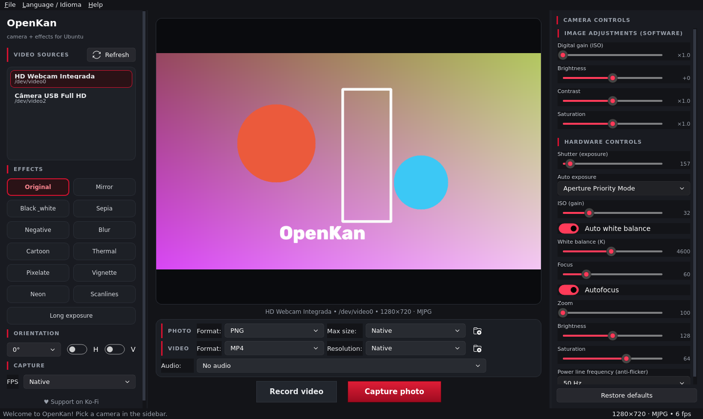

# OpenKan 🎥

**Webcam app with real-time effects for Ubuntu** — inspired by [Webcamoid](https://webcamoid.github.io/), built with Python + PyQt6 + OpenCV.

*(README em português: [README.md](README.md))*



## Features

- **Real-time preview** with low latency (the buffer always keeps the newest frame)
- **Live camera switching**: every detected V4L2 source shows up in the sidebar — click to switch without restarting
- **12 real-time effects**: Original, Mirror, Black & white, Sepia, Negative, Blur, Cartoon, Thermal, Pixelate, Vignette, Neon and Scanlines
- **Orientation**: 0°/90°/180°/270° rotation and horizontal/vertical flip
- **Manual camera controls** (read straight from the V4L2 driver — each webcam shows what it actually has):
  - Shutter (exposure) with auto/manual mode
  - ISO (gain), Focus and Zoom
  - **Lens aperture (iris)** — when the hardware exposes it
  - Auto white balance and temperature (K)
  - Brightness, contrast, saturation, hue, sharpness, gamma, anti-flicker (50/60 Hz) and more
  - **Restore defaults** button
- **Photos** as PNG or JPEG, with optional max size
- **Videos** as **MP4, MKV, AVI or WebM**, with selectable resolution (native, 1080p, 720p, 480p, 360p)
- **Video recording with audio** — pick the source (microphone, system output…) via PulseAudio/PipeWire
- **Selectable folders** for photos and videos (folder icon in the settings bar), plus "Open photos/videos folder" menu items
- **Bilingual UI** (English and Portuguese), switchable at runtime in the **Language / Idioma** menu
- **Animated notifications** (toasts), capture flash, pulsing red border while recording
- **Graphite dark theme with blood-red accents**, animated Fluent widgets ([PyQt-Fluent-Widgets](https://qfluentwidgets.com))
- Works on **Wayland and X11**
- Persistent preferences (camera, effect, language, folders, formats…)

## Requirements

- Ubuntu 22.04 / 24.04 or derivatives (Debian works too)
- Python 3.9+
- A V4L2 webcam (`/dev/video*`)

The installer handles the rest: `python3-venv`, `libgl1`, `v4l-utils`, `ffmpeg` (audio), `pulseaudio-utils`, PyQt6, PyQt-Fluent-Widgets, OpenCV and NumPy.

## Install

```bash
cd openkan
bash install.sh
```

Then launch from the applications menu (**OpenKan**) or from a terminal:

```bash
openkan
```

### Run from source (without installing)

```bash
bash openkan-launcher        # uses the installed venv, or falls back to system python
# or
python3 run.py               # needs PyQt6 + Fluent-Widgets + OpenCV system-wide
```

## Usage

| What | Where |
| --- | --- |
| Switch camera | Sidebar → **Video sources** → click the camera |
| Refresh the list | **Refresh** button (⟳) |
| Effects | Sidebar → **Effects** |
| Rotate / flip | Sidebar → **Orientation** |
| Shutter, ISO, aperture, white balance… | Right panel → **Camera controls** |
| Photo format/size and folder | Bottom bar → **PHOTO** |
| Video format/resolution, audio, folder | Bottom bar → **VIDEO** |
| Record video | **Record video** button (preview border pulses red) |
| Capture photo | Red **Capture photo** button (flash + notification) |
| Switch language | **Language / Idioma** menu → English or Português |

### Keyboard shortcuts

| Shortcut | Action |
| --- | --- |
| `Ctrl+Shift+S` | Save photo as… |
| `Ctrl+Q` | Quit |
| `F1` | About |

## Manual camera controls

The **Camera controls** panel shows exactly what **your driver** exposes (the same list as `v4l2-ctl --list-ctrls-menus`). Basic webcams may not have iris/zoom — in that case the control simply doesn't appear. Moving a manual control automatically turns off the corresponding auto mode (exposure, white balance, focus), like a real camera.

## Recording audio

Recording uses `ffmpeg` to capture the chosen source (PulseAudio/PipeWire microphones and output monitors) and mux it into the video at the end (`-c:v copy`, no re-encoding). Without `ffmpeg`, videos are saved without audio and nothing else changes.

## Troubleshooting

- **No camera detected** — check with `v4l2-ctl --list-devices` (`v4l-utils` package), then click **Refresh**.
- **Camera busy** — close the app that is using it (browser, Cheese…).
- **No controls in the panel** — install `sudo apt install v4l-utils`.
- **No audio in recordings** — install `sudo apt install ffmpeg pulseaudio-utils`.
- **Old "can't be used to capture by name" warning** — a bug in the previous version (UbuntuCam 1.x), already fixed: OpenKan opens cameras by numeric index.
- **Wayland** — no extra setup needed; Qt uses the native Wayland backend. In rare environments, force `QT_QPA_PLATFORM=xcb openkan`.

## Uninstall

```bash
bash uninstall.sh
# also removes the old UbuntuCam install, if present:
bash uninstall.sh --remover-ubuntucam-antigo
```

Saved photos and videos are preserved.

## Code layout

```
openkan/
├── openkan/
│   ├── cameras.py        # camera detection (opens by INDEX, not by name)
│   ├── captura.py        # capture threads + orientation
│   ├── controles_v4l2.py # manual controls via v4l2-ctl
│   ├── efeitos.py        # 12 real-time filters
│   ├── gravacao.py       # video + audio (ffmpeg) + mux
│   ├── salvar_foto.py    # photos (png/jpg) and folders
│   ├── traducao.py       # pt/en dictionary
│   ├── janela.py         # UI (graphite + blood red, Fluent widgets)
│   └── main.py           # entry point
├── openkan-launcher      # launcher
├── openkan.desktop       # menu shortcut
├── install.sh / uninstall.sh
└── requirements.txt
```

## License

This project's code is under the **MIT** license (see `LICENSE`).

The UI library [PyQt-Fluent-Widgets](https://github.com/zhiyiYo/PyQt-Fluent-Widgets) is **GPL-3.0** — if you redistribute OpenKan as a whole (including it), the combined work must comply with GPL-3.0. For personal use, study and modification, you are free.

Photos and videos you record are 100% yours. 🙂

## Author

**Racxus Dev** — [github.com/racxusdev](https://github.com/racxusdev) · [ko-fi.com/racxus](https://ko-fi.com/racxus)
